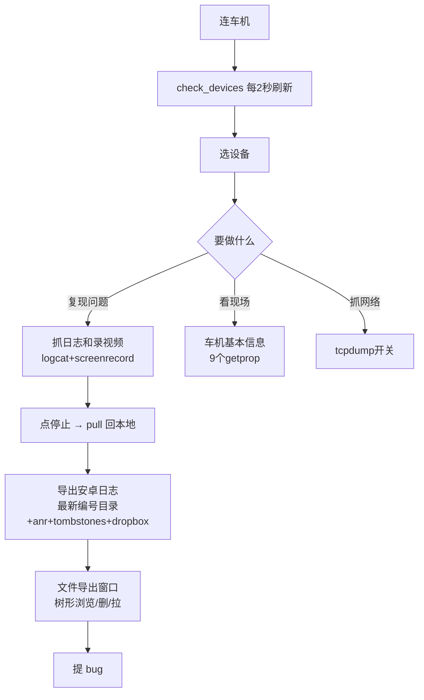

# SynTestUtil 源码级解析（test_tools V1.0.39）

> 分析对象：`C:\Users\zuo20\Downloads\SynTestUtil\SynTestUtil\test_toolsV1.0.39\test_tools`
> 分析日期：2026-11-04
> 用途：作为**需求来源**与**自研工具演进依据**，不是使用手册
> 敏感信息处理：文中的口令、激活码、MAC、第三方签名密钥一律脱敏为 `<已脱敏>`，不落原文

---

## 0. 分析方法与可信度

这个目录里**没有 .py 源码**，只有打包中间产物。文档是从二进制还原出来的：

| 证据 | 得到什么 | 可信度 |
|---|---|---|
| `build/main/main.pkg`（PyInstaller CArchive，42.7 MB） | 归档目录 277 项、入口脚本 `main`（27.7 KB 压缩 / 75.4 KB 字节码） | 【实测】 |
| `main` 脚本字节码（Python 3.8） | 反编译出 **104 个方法**（89 个完整、15 个小函数失败），合计 2376 行可读代码 | 【实测】 |
| `build/main/PYZ-00.pyz` | 662 个模块，业务模块只有 `WinUI` 一个（其余全是标准库/三方库） | 【实测】 |
| `WinUI` 字节码常量池 | 217 条界面字面量（按钮/标签/页签文本）+ 控件对象名 | 【实测】 |
| `dist/` 数据文件 | `pz.json`、`包名列表.txt`、`下线配置.json`、`dark.qss`、`icon/`、`sign.js` | 【实测】 |
| `main.spec`、`build/main/*.toc` | 构建参数、Python 版本、打包方式 | 【实测】 |

**明确的能力边界**

- 15 个方法反编译失败（`se` / `ca` / `open_` / `sele_can` / `contains_chinese` / `get_path` / `apk_version` / `getprop` / `cxhj` / `cxxhhj` / `get_all_parents` / `fill_tree` / `Mywindow` 类体本身）。这些我用**字节码常量 + 符号表**还原了行为，标注为【推断·字节码】。
- 页签与按钮的**分组归属**部分靠字符串顺序推断，标注【推断】。
- 没有任何注释和变量命名线索——变量名是反编译出的原名（`aa`、`bb`、`t1`、`kk` 之类），原作者的意图只能从行为反推。

---

## 1. 工具定位

一句话：**面向广汽车机（GXATEK / Syncore 座舱）的 PyQt6 单窗口 adb 工具箱，把测试岗每天要敲的一串 adb 命令做成按钮。**

| 项 | 值 |
|---|---|
| 名称 | 测试工具 V1.0.39（窗口标题即版本号） |
| 形态 | Windows 桌面 GUI，单主窗口 + 若干弹出小窗 |
| 技术栈 | Python 3.8 + PyQt6 + QDarkStyle 主题 + PyInstaller 打包 |
| 目标设备 | 广汽车机（`syncore.space.*` / `com.gxatek.*` / `com.gac.cloud.app`） |
| 设备通道 | `subprocess` 直接拼 `adb -s <serial> shell ...`（**没有用 adbutils**） |
| 代码量 | 单文件 `main.py` 约 **2430 行**（最后一个方法在 2431 行）+ 生成的 `WinUI.py` |
| 主线程模型 | UI 线程 + `ThreadPoolExecutor(max_workers=12)` + 一条 `while` 轮询线程（2 秒） |

**和另一个版本的区别**：`SynTestUtil/SynTestUtil/` 下那个 exe 是重构过的（拆成 `tools.commons.adb` 等 7 个模块、用 adbutils、日志走 polaris）。**本目录这一份是老的单文件版本**，所有逻辑都在一个类里。两份功能集大致相同，但本份更"原始"，适合当需求来源——因为它把"测试岗到底要按哪些按钮"暴露得很直白。

---

## 2. 工程结构与构建

```
test_tools/
├─ main.spec                  PyInstaller 配置（内含原作者本机绝对路径）
├─ pz.json                    9 个路径的默认配置（全空）
├─ build/main/                打包中间产物（本次分析的主证据）
│  ├─ main.pkg                42.7 MB CArchive，含入口脚本与全部二进制
│  ├─ PYZ-00.pyz              662 个纯 Python 模块
│  ├─ Analysis-00.toc / xref-main.html / warn-main.txt
│  └─ localpycs/*.pyc         引导用 pyc
└─ dist/                      可直接运行的产物
   ├─ main.exe                43 MB 单文件
   ├─ dark.qss                QDarkStyle v0.4.0（qtsass 生成），底色 #19232D，前景 #DFE1E2
   ├─ yangshi.qss             备用主题
   ├─ icon/                   7 张 png（功能/应用图标/文件夹/文件/下拉/进入/文件导出记录）
   ├─ 包名列表.txt             22 个业务包（中文名:包名）
   ├─ 下线配置.json            4 段下线配置字典（0x0101 / 0x0100 / 0xAE0D / 0xAE0B）
   ├─ sign.js                 第三方站点签名/解密脚本（含硬编码密钥，见 §7）
   ├─ log.txt                 运行日志（231 KB）
   └─ 269953fb.0 / c8750f0d.0 两个证书文件（文件名是 openssl subject_hash_old 格式）
```

**构建参数（main.spec 实录）**

```python
Analysis(['D:\\pythonProject\\zaqizaba\\pyqt6_demo\\main.py'], ...)
EXE(..., name='main', console=False, upx=True,
    icon=['D:\\pythonProject\\zaqizaba\\pyqt6_demo\\icon\\应用图标.png'])
```

三个值得记的点：

1. **`console=False`** → 无控制台，所有错误只能进 `log.txt`，用户看不到异常。
2. **`upx=True`** → 有 UPX 压缩，部分杀软会误报，也让静态分析更麻烦。
3. **源码路径写在 spec 里** → 交付物自带作者本机目录结构（`zaqizaba` 是"杂七杂八"的拼音），这属于打包卫生问题。

---

## 3. 启动流程（`__init__` 逐行还原）

这是整个工具最该被抄、也最该被改的部分。真实顺序如下：

```python
super().__init__()
self.log_()                      # 1. 配置 logging → ./log.txt，格式含 文件[行号]-函数名-级别
self.initUI()                    # 2. 窗口图标 + 系统托盘
self.yangshi()                   # 3. os.chdir(程序目录) + 加载 dark.qss
self.setupUi(self)               # 4. 加载生成的界面（8 页签 / 59 按钮）
self.peizhi()                    # 5. 读 pz.json → 填充 9 个路径输入框
self.check_devices()             # 6. adb devices → 填充设备下拉框
self.setFixedSize(955, 626)      # 7. 固定窗口尺寸（不可缩放）
self.version = "测试工具V1.0.39"   # 8. 版本号写死在代码里
self.pool = ThreadPoolExecutor(max_workers=12)
self.dbc_load()                  # 9. 读 DBC 文件（Windows-1250 编码）
self.pp = 1
self.pool.submit(self.devices)   # 10. ★ 起一条常驻轮询线程
...（40+ 行控件信号连接）...
self.apk_list()                  # 11. 读 包名列表.txt → self.apk{中文名: 包名}
self.comboBox.addItems(self.apk)
self.comboBox_3.addItems(['默认','转俄文','转泰文','转阿拉伯语','转西班牙语'])
keyboard.add_hotkey("alt+d", self.hotkey)   # 12. 全局热键（第三方 keyboard 库，需管理员）
self.statusbar.showMessage("可使用快捷键 ALT+D 显示隐藏窗口…")
self.pool.submit(self.open_)     # 13. ★ 启动即向公网 POST 一次（见 §7）
self.moyu()                      # 14. ★ 同步请求两个外网接口（timeout=1），失败才回落
self.houtai()                    # 15. 7 个后台链接写成富文本
self.get_ip()                    # 16. adb shell ifconfig 取 wlan0 IP
```

**三个关键设计（值得借鉴）**

| 设计 | 做法 | 评价 |
|---|---|---|
| **设备轮询** | `devices()` 里 `while self.pp: check_devices(); sleep(2)` | ✅ 完全解决"插拔后界面不同步"。这正是我方 v7.8 补的能力 |
| **保留用户选择** | `check_devices` 先存 `old_devices`，刷新后若仍存在则 `setCurrentIndex` 复位 | ✅ 细节到位，不会因为刷新把选中的设备打回第一台 |
| **统一装饰器** | `@try_` 吞异常写日志；`@devices_` 校验下拉框 | ⚠️ 思路好，但吞异常导致故障不可见 |

**一个明显缺陷：启动被网络阻塞**

```python
res = requests.get("https://www.wpbkj.com/moyu_php/", timeout=1)
res = requests.get("https://api.oick.cn/dutang/api.php", timeout=1)
```

`moyu()` 在 `__init__` 里**同步**执行，最坏情况启动多等 **2 秒**，而且这两个域名在内网环境必然超时。用户体验是"双击后一两秒才出窗口"，原因就是这个"每日毒鸡汤"。

---

## 4. 界面结构

### 4.1 骨架

| 项 | 值 |
|---|---|
| 窗口 | 955 × 626，`setFixedSize` 固定，不可拉伸 |
| 容器 | `tabWidget`，**8 个页签** |
| 分组 | 8 个 `groupBox` |
| 按钮 | **59 个** `pushButton` |
| 输入 | `lineEdit` × 14、`comboBox` × 4、`textEdit` × 2 |
| 输出 | `textBrowser` × 8（每个功能块一个，互不干扰） |
| 主题 | QDarkStyle（深色），路径 `./dark.qss` |

### 4.2 页签与主要按钮（文本为界面原文）

| 页签【推断】 | 按钮/标签文案（原文） |
|---|---|
| **常用** | 抓日志和录视频 / 截图并打开 / tcpdump日志 / 环境切换 / 清理日志文件夹 / 投屏 / 屏幕坐标 / 车机wifi连接 / 文件导出 / 实时日志 / 主题切换 / 车机重启 / adb重启 / can重启 / 当前使用设备 / 刷新 / 连接无线adb / 断开无线adb |
| **小工具** | 安装应用依赖 / 版本查询 / 工程模式 / 应用push / 包名和Activity / 应用install / 导出apk / 清理应用缓存 / 关闭应用进程 / 清除 / 车机基本信息 |
| **导航相关** | 美行日志 / 星河日志 / 清除导航日志 / 查询日志文件 / 导航授权 / 请先打开地图手动激活弹窗 |
| **can相关** | 输入信号查询： / 十六进制 / 二进制 / bit位( 7<----0 ) / 查询 |
| **车机代理** | 代理查询 / 开启代理 / 关闭代理 / push证书 / 下线配置 / 打开下线配置页 |
| **串口工具** | 打开ADB / 重启车机 / 串口工具 / 打开 / 导出安卓日志 |
| **翻译** | （`comboBox_3` 语种：默认/转俄文/转泰文/转阿拉伯语/转西班牙语） |
| **下线配置** | 请输入要查询的下线配置名称： / 查询 |

> 页签归属是按字符串出现顺序 + 按钮 handler 推断的，实际视觉分组可能有出入，上机看一眼即可校正。

### 4.3 三个独立小窗（都是运行时用代码画的，不在 WinUI 里）

| 窗口 | 尺寸 | 内容 |
|---|---|---|
| **文件导出** | 661 × 426 | 左 `QTreeWidget`(400×421) 浏览设备目录树 + 右「默认导出路径 / 选择 / 导出 / 删除」 |
| **应用push** | 661 × 426 | 动态生成 N 行「apk 路径 + 目标目录下拉框」+「一键push」 |
| **主窗口内的信息区** | — | `label` 富文本展示车型/VIN/环境等（`setWordWrap(True)`） |

**窗口 Icon 与托盘**：`icon/功能.png` 作窗口图标，`icon/应用图标.png` 作托盘图标，托盘点击 = 显示/隐藏；`ALT+D` 全局热键同效。这是"测试时别占屏幕"的正确做法。

---

## 5. 功能详解（按用户动作，而不是按代码顺序）

> 每个功能都写成：**触发 → 实际命令 → 产物 → 备注**。
> 命令里的 `<dev>` 指下拉框选中的序列号，所有命令都带 `-s`。

### 5.1 抓日志 + 录屏（`xg`，按钮文案会变成「停止」）

这是一组**开关式**功能，用按钮文字本身当状态机（`if self.pushButton_3.text() != "停止"`）。

**开始**

```bash
adb -s <dev> logcat -c                                   # 先清缓冲
adb -s <dev> logcat -v time  > <logpath>\MM-DD-HHMMSS.txt   # ⚠️ 见下
adb -s <dev> shell "mkdir /sdcard/screenrecord/"
adb -s <dev> shell "screenrecord /sdcard/screenrecord/<time>.mp4"
```

⚠️ 日志落盘用的是 `with open(...) as f: subprocess.Popen([...'logcat','-v','time'], stdout=f, shell=True)` —— **这是唯一一处没有走 `shell` 拼字符串的地方**，但它仍然把文件句柄给了子进程，父进程退出后句柄在 `f` 关闭时可能中断；实际使用中能跑，属于"能用但脆弱"。

**停止**

```python
self.stop()   # 用 psutil 按 pid 杀进程树（含子进程）
adb -s <dev> pull /sdcard/screenrecord <sppath>
adb -s <dev> shell rm -rf /sdcard/screenrecord
```

**评价**：`psutil` 杀进程树是正确的（adb 会 fork），比 `taskkill` 精准；拉回后删设备端文件也正确（避免撑爆 `/sdcard`）。

### 5.2 截图并打开（`jietu`）

```bash
adb -s <dev> shell        # 一次性交互会话里写三条：
  mkdir /sdcard/screencap/
  screencap /sdcard/screencap/<time>.png
adb -s <dev> pull sdcard/screencap/ <jtpath>
adb -s <dev> shell rm -rf /sdcard/screencap
start <jtpath>\screencap\<time>.png      # Windows 默认程序打开
```

**评价**：用一个 `adb shell` 会话写三条命令，比三次 `adb shell` 快（省两次协议往返）。这是它少数"性能上做对了"的地方。**截完自动打开**也很符合测试岗习惯（立刻贴到 bug 里）。

### 5.3 tcpdump（`tcpdump`，同样按钮变「停止」）

```bash
adb -s <dev> root                        # 必要时
adb -s <dev> shell "tcpdump -i any -w /data/<time>.pcap"
# 停止后
adb -s <dev> pull /data/<time>.pcap <tcppath>
adb -s <dev> shell rm /data/<time>.pcap
```

⚠️ 用 `p_t.stdin.write(...)` + `communicate()` 启动，`tcpdump` 本身不返回，靠外部 `kill(pid)` 结束。`pcap` 落在 `/data/` 而非 `/sdcard/`，需要 root。

### 5.4 投屏（`scrcpy_`）

```python
os.chdir(<投屏软件所在目录>)
os.system("scrcpy -s <dev>")
```

路径从 `lineEdit_11` 读，为空或不存在则弹「请检查投屏路径」。**注意它 `chdir` 到了 scrcpy 目录**——这会影响后续所有相对路径操作（全局 `os.chdir` 是这程序的一类系统性问题，见 §7）。

### 5.5 车机 WiFi 连接（`wifi_connect`）

```bash
adb -s <dev> shell cmd wifi set-wifi-enabled enabled
adb -s <dev> shell cmd wifi connect-network <SSID> wpa2 <口令>   # 口令硬编码 <已脱敏>
```

**评价**：`cmd wifi connect-network` 是 Android 11+ 的正确写法（比 `svc wifi` + 手动输入界面可靠）。但 **SSID 和口令写死在代码里**，换项目即失效，且是敏感信息泄露。

### 5.6 屏幕坐标（`xy`）与夜间模式（`mode_choice`）

```bash
# 坐标（开发者选项里的"指针位置"）
adb shell settings get system pointer_location
adb shell settings put system pointer_location 1|0     # 开关切换

# 夜间模式（需要 su）
adb -s <dev> shell "su 0 cmd uimode night yes|no"
```

`mode_choice` 用"先读再切"实现**切换**语义：读到的值含 `no` 就切 `yes`，含 `yes` 就切 `no`。这是按钮做开关的通用手法。

### 5.7 文件导出（`export_files`，独立窗口 + 目录树）

**这是全工具技术含量最高的一块**（`fill_tree` / `get_all_parents` / `soft_link` / `del_file` / `pull_files`）：

```python
# 展开节点时按需加载：ls -l <path>
adb -s <dev> shell ls -l <path>
# 逐行判断
if line 开头是 'd' → 文件夹图标，可继续展开
if line 开头是 'l' → 递归 soft_link() 解析真实路径
if 'total' in line → "文件夹"
else → "文件"
# 导出
adb -s <dev> pull <path> <本地目录>
# 删除（有 QMessageBox 确认）
adb -s <dev> shell rm -rf <path>
```

**优点**：树形浏览比"背路径"友好得多，是 GUI 相对 CLI 的真实优势。
**缺点**：
- 每次展开都**同步** `subprocess`，大目录（几百个文件）会卡 UI；
- `soft_link` 是**递归调用自己**，遇到环形软链会栈溢出；
- 删除用的是 `rm -rf` + 只确认一次，误删风险高（没有回收站概念）。

### 5.8 导航日志三件套（`xh_log` / `mx_log` / `clear_maplog` / `cx_maplog`）

| 方法 | 动作 |
|---|---|
| `xh_log`（星河） | 拉 `/sdcard/autonavi/navi/logs` + `/data/anr` + `/data/tombstones` + `/data/system/dropbox` → `<mappath>\<MM-DD-HHMMSS>\` |
| `mx_log`（美行） | 同上，但导航日志换成 `/sdcard/Android/data/space.syncore.cockpit.map/files/autonavi/navi/logs` |
| `clear_maplog` | `rm -rf` 两处导航日志（有确认框） |
| `cx_maplog` | 列出最新 `/log/android_log/androidlog/<最大编号>/logcat` 内容 + 两处导航日志的 `ls -l` |

**注意一个共性**：`xh_log` / `mx_log` 每次都把 **anr + tombstones + dropbox** 一起拉走。这是测试岗的真实习惯——**出问题时要的是"现场全量"，不是"我猜需要的那一个"**。

### 5.9 导出安卓日志（`pull_androidlog`）—— 逻辑最巧的一段

```python
adb shell ls /log/android_log/androidlog            # 得到 351 352 ... 503
text = re.findall("[^0-9]+", file[0])[0]            # 提取目录名前缀（如 "androidlog"）
k = [int(i.replace(text,"")) for i in file if i]     # 提取编号
kk = sorted(k)[-1]                                   # 取最大编号
adb pull /log/android_log/androidlog/<前缀><kk> <logpath>
adb pull /log/android_log/cycliclog <logpath>/<前缀><kk>
adb pull /data/anr          <logpath>/<time>\
adb pull /data/tombstones   <logpath>/<time>\
adb pull /data/system/dropbox <logpath>/<time>\
```

**它自动找"最新一轮"日志目录**（编号最大的），这是很实用的启发式。但有两个坑：
- `file[0]` 若为空（`ls` 失败）会 `IndexError`；
- `sorted(k)[-1]` 在目录名不是纯数字后缀时会抛异常。

### 5.10 APK 四件事（`apk_list` / `apk_version` / `pull_apk` / `installapp`）

```bash
# 版本查询：22 个包逐个查
adb -s <dev> shell dumpsys package <pkg> | findstr versionName

# 导出：先找路径（split APK 会返回多个）
adb -s <dev> shell pm list package -f | findstr <pkg>
# → 结果按 ":" 和 "=" 切分，得到 base.apk 与 config.*.apk
adb -s <dev> pull <path> <本地文件>

# 安装
adb -s <dev> shell setprop persist.sv.enable_adb_install 1
adb -s <dev> disable-verity
adb -s <dev> remount
adb -s <dev> install -r -d -t <apk>
```

**这套 `setprop + disable-verity + remount` 是广汽车机的"解锁安装"固定流程**，普通 Android 不需要。这是**项目知识**，非常值得配置化。

**版本查询的代价**：22 个包 = 22 次 `dumpsys`，串行执行，实测 5~8 秒（`information` 里甚至把 `time.time()` 差打出来给用户看）。

### 5.11 应用控制（`close_app` / `clear_Cache` / `get_package`）

```bash
# 关闭进程：先 ps 找 pid，再 kill -9
adb shell ps | findstr <pkg>      →  pid = 第 2 列
adb shell kill -9 <pid>

# 清数据
adb shell pm clear <pkg>

# 当前前台（这块和我方 `now` 同一目的）
adb shell dumpsys window | findStr mCurrentFocus
→ 正则 u0 (.*?)}  提取 "包名/Activity"
```

**`get_package` 的 Bug**：`re.findall("u0 (.*?)}", i)[0]` 在多窗口/分屏时可能匹配到非前台 window；且 `findStr`（大小写混写）在部分 shell 上不认，标准写法是 `findstr` 或 `grep`。

### 5.12 车机基本信息（`information`）—— 一屏看全车

9 个属性并行取（用线程池），然后拼成多行 label：

| 属性 | 含义 |
|---|---|
| `ro.product.vehicleplatform` | 车型 |
| `ro.product.gacvehicleplatform` | 车型值（我方也用这个） |
| `persist.sys.vehicle.vin` | VIN |
| `ro.build.version.short_name` | 系统版本 / SOC 版本 |
| `ro.product.mcu.version` | MCU 版本 |
| `persist.syncore.active.code` | 车机激活码 |
| `persist.log.tag` | 安卓 log 等级 |
| `persist.sys.autofly.web.deploy` 等 | 车机环境（`cxhj` 判断） |
| `persist.sys.autofly.web.domain` 等 | 星河应用环境（`cxxhhj` 判断） |

**环境识别逻辑（`cxhj`）**

```python
if "pv" in 值:       测试环境
elif "pre" in 值:    预发布环境
elif "public"/"gmc": 正式环境
else:                未知环境
```

`cxxhhj` 同理，用 `api-test` / `api-pre` / `api` 判断。**这和我方 `:syncore` 是同一件事**——但它是"按环境名猜"，我方是"三个属性全量比对"，后者更准。

### 5.13 代理与证书（`set_proxy` / `del_proxy` / `sele_ca` / `push_ca` / `ca`）

```bash
# 开代理：把 PC 的 IP 填进去，端口固定 8888（mitmproxy 默认）
adb shell settings put global http_proxy <PC_IP>:8888
adb shell settings list global | findstr global_http_proxy_host   # 回读校验

# 关代理：删三个键 + 重启
settings delete global http_proxy
settings delete global global_http_proxy_host
settings delete global global_http_proxy_port
adb reboot

# 查证书：看 /system/etc/security/cacerts 里有没有 -rw-rw 权限的条目
adb shell ls -l /system/etc/security/cacerts

# 装证书（ca 生成 hash 文件名）
adb shell openssl x509 -inform DER -subject_hash_old -in /sdcard/<cer>
adb remount  →  失败则 disable-verity + reboot
adb push <hash>.0 /system/etc/security/cacerts
adb shell "cd /system/etc/security/cacerts && chmod 664 ./<hash>.0 && reboot"
```

**这段是全工具最"专业"的部分**：`subject_hash_old` 算 Android 系统证书文件名、`chmod 664`、`remount` 失败自动 `disable-verity` 再重启。做抓包的人一看就知道是真踩过坑的。

**但有个明显疏忽**：`del_proxy` 结束直接 `adb reboot`，用户没有拒绝机会；关代理本身不需要重启（只是部分 App 会缓存）。

### 5.14 导航授权（`map_shouquan`）—— 最脆弱的功能

```bash
adb shell input tap 1891 730      # 点输入框（两次）
adb shell input keyevent 4        # 返回
adb shell input keyevent KEYCODE_DEL × 24   # 连删 24 次清空
adb shell input text <激活码>      # 硬编码 <已脱敏>
adb shell input keyevent 61       # TAB
adb shell input tap 1430 1062     # 点确认（两次）
adb shell setprop sys.vehicle.hardware.map.active.code <授权码>   # 硬编码
adb shell am force-stop space.syncore.cockpit.map
```

**问题**：坐标 `(1891,730)` / `(1430,1062)` 是**按某块屏写死的**。换分辨率、换主题、换 UI 版本立即失效；没有截图比对、没有等待、没有失败检测。这是"能用一次"的脚本，不是功能。

### 5.15 下线配置查询（`xxpz` / `sele_can`）

**`xxpz`**：在 `下线配置.json` 的 4 个报文段里按关键字搜配置项，输出 HTML 表格：

```
| did | Byte | Bit | 配置名称 | 配置参数 |
| 车辆配置0101 | 0 | 0-1 | 车型配置 | 0:传统车 1:EV车 … |
```

4 个段：`0x0101`（车辆配置）、`0x0100`（主机配置）、`0xAE0D`（仪表）、`0xAE0B`（仪表）。

**`sele_can`**：解析 `.dbc` 文件，匹配 `BO_ <id> <名称>` 与 `SG_ <信号>`，输出信号表。`bit位( 7<----0 )` 这个标签说明它按 Motorola/Intel 两种字节序展示。

**评价**：这是**CAN 报文调试**的真实需求，且数据外置成 JSON/DBC 是对的。但 `xxpz` 的实现有**四层嵌套 for 循环 + 重复覆盖循环变量 `i`**（`for i in a.keys(): ... for i in b.keys(): ...`），导致结果重复/漏项，是明显 bug。

### 5.16 杂项

| 功能 | 实际行为 |
|---|---|
| `bin_to_hex` / `hex_to_bin` | 8bit 互转，改一个框自动同步另一个（先 `disconnect` 信号防递归） |
| `gongcheng`（工程模式） | `version.short_name` 含 `AY5` → 启 `com.google.android.car.kitchensink`；否则 `com.android.engmode/.MainActivity` |
| `wifi_adb` / `wifidisconnect` | `adb connect <ip>` / `adb disconnect`，然后刷新设备列表 |
| `clear_folder` | 递归删除 4 个本地目录（日志/录屏/截图/tcpdump），**有确认框** |
| `houtai` | 7 个后台链接（消息后台、埃安商城、传祺商城、探索传祺）按测试/正式两套配好 |
| `fanyi` | 调有道翻译 web 接口，AES 解密返回（**密钥硬编码，已脱敏**） |
| `moyu` | 抓两个外网"毒鸡汤"接口，填到 label（**启动阻塞源**） |
| `open_` / `close_` | 启动/退出向 `119.91.250.167:5000` 上报 MAC、时间戳、版本（见 §7） |
| `get_logcat` / `push_files` | **"功能未开发"**（占位方法） |

---

## 6. 数据与配置

### 6.1 `pz.json`（9 个路径，全部可配）

```json
{"logcat":"", "screenrecord":"", "screencap":"", "tcpdump":"", "maplog":"",
 "pushapk":"", "pullapk":"", "dbc_file":"", "scrcpy":""}
```

**约定很关键**（`peizhi` / `import_config` 里都实现了同一套回退）：

| 键 | 空值时的默认 | 非空时的语义 |
|---|---|---|
| `logcat` | `<exe目录>/log` | 日志落盘目录 |
| `screenrecord` | `<exe目录>/screenrecord` | 录屏目录 |
| `screencap` | `<exe目录>/screencap` | 截图目录 |
| `tcpdump` | `<exe目录>/tcpdump` | 抓包目录 |
| `maplog` | `<exe目录>/map` | 导航日志目录 |
| `pushapk` | `<exe目录>` | push 源目录 |
| `pullapk` | `<exe目录>/` | apk 导出目录 |
| `dbc_file` | `""` | DBC 文件绝对路径 |
| `scrcpy` | `""` | scrcpy.exe 绝对路径 |

**这 9 个键就是"测试岗的产物清单"**——非常有参考价值，可以和我方的输出目录策略对照。

### 6.2 `包名列表.txt`（22 个业务包）

格式 `中文名:包名`，一行一个，`apk_list()` 读进字典供下拉框用。

覆盖范围（说明它服务的车机装了哪些东西）：个人中心、账号中心、我的车、消息中心(hmi/服务)、adigo商城、探索车辆、日程助手、导航、聚合媒体、车服务、SystemUI、语音助手、场景大师(魔方/ispace)、QQ音乐、AIGC壁纸、智能推荐、探索昊铂、壁纸、微信小程序、天气。

> 其中 `com.gxatek.cockpit.scenesengine`（智能推荐）正是你日常在测的那个。

### 6.3 `下线配置.json`（4 段）

```json
{"0x0101": {"车型配置": ["0","0-1","0:传统车\n1:EV车..."], ...},
 "0x0100": {...}, "0xAE0D": {...}, "0xAE0B": {...}}
```

每项是三元组 `[Byte, Bit范围, 取值说明]`。**这是"车型配置字"的字典**，属于车厂内部知识，很值得沉淀。

### 6.4 `log.txt`（运行日志）

```
2026-10-26 17:12:03 - main.py[line:2247] - check_devices - INFO: ====
```

格式 = `%asctime% - %filename%[line:%lineno%] - %funcName% - %levelname%: %message%`。
**问题**：97% 的行只有 `INFO: ====`（每个方法开头都 `logging.info("====")`），真正的信息量在 `ERROR:` 行里，但**全是 `traceback.format_exc()` 原文**——等于把异常栈当日志，没有一句人话。

---

## 7. 代码质量与风险清单

### 7.1 结构性问题（会影响能否继续演进）

| # | 问题 | 证据 | 影响 |
|---|---|---|---|
| 1 | **单文件 2430 行、一个类 104 个方法** | `Mywindow` 类体 | 改一个功能要读整个文件；无法单测 |
| 2 | **业务与 UI 完全耦合** | 每个方法里都有 `self.textBrowser.append` | 无法复用到 CLI/批量场景 |
| 3 | **命令全部字符串拼接** | `f"adb -s {device} shell ..."` + `shell=True` | 路径/参数含空格即崩；有命令注入面 |
| 4 | **无超时** | 所有 `subprocess.Popen` | 设备掉线即永久挂起，UI 卡死 |
| 5 | **`except:` 裸捕获 + 只写日志** | 几乎每个方法 | 失败静默，用户只看到"没反应" |
| 6 | **`os.chdir` 全局切换** | `yangshi`/`scrcpy_`/`export_files`/`save_pz` | 多线程下相对路径竞态，文件可能写到别的目录 |
| 7 | **两套配置读取逻辑重复** | `peizhi` 与 `import_config` 各写一遍 | 一处改了另一处忘，行为分叉 |
| 8 | **`peizhi` 的缩进错误（疑似）** | `if "dbc_file" not in str(pz): ... else: <后面全部缩进在 else 里>` | pz.json 缺 `dbc_file` 键时，**9 个路径全都不加载** |

### 7.2 安全与合规（必须在文档里标出来）

| 项 | 说明 |
|---|---|
| **硬编码口令** | WiFi SSID + 口令写死在 `wifi_connect`（<已脱敏>） |
| **硬编码激活码** | 导航授权码、`map.active.code` 写死在 `map_shouquan`（<已脱敏>） |
| **硬编码第三方密钥** | 有道翻译的签名 key、AES key/iv 明文写在 `fanyi` 与 `sign.js`（<已脱敏>） |
| **外发数据** | `open_` / `close_` 把**本机网卡 MAC + 时间 + 版本号** POST 到公网 IP `119.91.250.167:5000`；`close_` 里还带一个 MAC 白名单判断 |
| **打包路径泄露** | `main.spec` 内含作者本机目录 `D:\pythonProject\zaqizaba\...` |
| **`sign.js` 来源可疑** | 内含某站点请求签名与解密逻辑（硬编码密钥），与本工具功能无关，**不建议随包分发** |

> 说明：本节只做"存在性披露"，不复制任何密钥原文。如果这份工具要对外交付，以上 5 项都必须先清理。

### 7.3 功能性 Bug（实测/推断）

| # | 现象 | 位置 |
|---|---|---|
| 1 | 启动多等 1~2 秒（两个外网请求） | `moyu` |
| 2 | `xxpz` 查询结果重复或漏项（循环变量 `i` 被内层覆盖） | `xxpz` |
| 3 | `get_package` 分屏时可能取错前台 | `get_package` |
| 4 | `pull_androidlog` 目录为空时 `IndexError` | `pull_androidlog` |
| 5 | `soft_link` 递归无深度限制 | `soft_link` |
| 6 | `pull_apk` 的 `apk[package]` 在包名不存在时 KeyError | `pull_apk` |
| 7 | `del_proxy` 强制重启，无确认 | `del_proxy` |
| 8 | 导航授权依赖写死坐标 | `map_shouquan` |

---

## 8. 与我方 CLI 工具的对照（这张表是全文重点）

| 维度 | SynTestUtil（GUI） | 我方 adb_log_export（CLI） | 结论 |
|---|---|---|---|
| 形态 | 桌面窗口，按钮点选 | 命令行，输入即执行 | 各有所长 |
| 设备轮询 | ✅ 2 秒循环 + 保留选中 | ✅ v7.8 起空闲探测（离线 1.2s / 在线 8s） | **已追平** |
| 命令拼接 | ❌ 全字符串 + `shell=True` | ✅ argv 逐个转义、无 `shell=True` | **我方更安全** |
| 超时 | ❌ 无 | ✅ `AdbCallTimeout` | **我方更好** |
| 错误处理 | ❌ 裸 except 写日志 | ✅ 提炼设备原话 + 建议 | **我方更好** |
| 配置 | 9 个路径（绝对路径） | ini 46 键 + cmds.ini 30 条命令 | 我方更可扩展 |
| **目录树浏览** | ✅ QTreeWidget 按需展开 | ❌ 只有 `ls` | **它赢**（GUI 的天然优势） |
| **录屏 + 日志联动** | ✅ 一个按钮同时起两个 | ❌ 无 | **它赢**（高频场景） |
| **tcpdump** | ✅ 开关式抓包 | ❌ 无 | **它赢** |
| **截图并自动打开** | ✅ | ⚠️ 有 `:shot` 但我方不自动打开 | 小幅落后 |
| **系统证书安装** | ✅ 完整流程 | ❌ 无 | **它赢**（专业度） |
| **代理开关** | ✅ 设置/回读/清除 | ❌ 无 | **它赢** |
| **DBC / 下线配置** | ✅ JSON + 解析 | ❌ 无 | **它赢**（项目知识） |
| **翻译** | ✅ | ❌ 无关 | 不需要 |
| **外发上报** | ❌ 有（风险） | ✅ 无 | **我方干净** |
| 可组合 | ❌ 按钮之间不能串联 | ✅ 命令可互相调用 | **我方赢** |
| 可脚本化 | ❌ | ✅ | **我方赢** |

**一句话结论**：它的优势集中在**"一次操作要同时做几件事"**（录屏+日志、截图+打开、抓包+拉回、证书+remount+重启），本质是**把一串命令打包成一个按钮**；我方的优势在**安全、可组合、可扩展**。这恰好互补。

---

## 9. 可落地的需求条目（按我方架构给落点）

> 落点标记：`配`=cmds.ini 配置化 / `:`=引擎命令 / `新`=需要新增能力 / `不做`

### P0（真能省时间的）

| 编号 | 需求 | 落点 | 验收标准 |
|---|---|---|---|
| R-01 | **一键录屏 + 抓日志**（一个动作同时起 logcat 落盘与 screenrecord） | `新` `:rec` | 一条命令开启、再一条停止并自动 pull 回来；停止后打印两个产物路径 |
| R-02 | **截图并自动打开** | `配` 改 `:shot` | 截图落盘后自动用系统看图器打开；`shot -n` 只存不开 |
| R-03 | **tcpdump 开关** | `配` `:cap` | 第一次执行开始抓、第二次执行停止并 pull 回 pcap |
| R-04 | **系统证书安装流程** | `配` | `remount` 失败自动 `disable-verity` + 提示重启；装完 `chmod 664` |
| R-05 | **代理开/关/查** | `配` | `:proxy on` / `:proxy off` / `:proxy` 查询；开关后回读校验 |
| R-06 | **今日现场包（snap）** | `新` `:snap` | 一条命令产出：截图 + 最近 N 行日志 + props + anr/tombstones/dropbox + 时间基准，打包成一个目录 |

### P1（补齐项目知识）

| 编号 | 需求 | 落点 |
|---|---|---|
| R-07 | 车机 9 项身份属性一屏输出（车型/车型值/VIN/系统版本/MCU/激活码/log 等级/两套环境） | `配` `:car` 或并入 `:sysinfo` |
| R-08 | 环境识别从"猜关键字"改为"三属性全量比对" | 已有 `:syncore`，补 `cxhj` 那套 `tsp.domain` |
| R-09 | APK 路径查询（支持 split APK 多路径） | `配` 增强现有包名直查，输出 `codePath` + 全部 split |
| R-10 | 导航日志三处路径一键拉取（星河/美行/anr+tombstones+dropbox） | `配` |
| R-11 | 清导航日志（带确认） | `配`（注意：与我方"去掉二次确认"的原则冲突，**建议只对 `rm -rf` 保留确认**） |
| R-12 | 工程模式跳转（按 `short_name` 分流 kitchensink / engmode） | `配` |
| R-13 | 安装解锁流程（`setprop enable_adb_install` + `disable-verity` + `remount`） | `配` |

### P2（可选）

| 编号 | 需求 | 说明 |
|---|---|---|
| R-14 | 目录树浏览 | 与我方"命令行"定位冲突，**不建议做**；需要时用 `:export` + 资源管理器 |
| R-15 | 下线配置 / DBC 查询 | 属于独立工具（数据 + 解析），**建议单独做**，不进 CLI |
| R-16 | 翻译 | 与本工具无关，**不做** |
| R-17 | 上报统计 | **永不做**（合规风险） |
| R-18 | 按坐标点 UI（导航授权） | **不做**。这是 UI 自动化（Appium/uiautomator2）的事，写死坐标必然失效 |

### 一条来自它的、值得抄的设计

> **"一次操作要把现场所有相关产物都收走"**（`xh_log`/`mx_log` 拉 anr + tombstones + dropbox + 导航日志）。
> 这比"用户自己挑要哪个"更符合测试现场——出事时你往往不知道缺的是哪个。

---

## 10. 未确认项（需要上机验证）

| # | 项 | 怎么确认 |
|---|---|---|
| 1 | 8 个页签的准确名称与按钮归属 | 打开 exe 截图核对 |
| 2 | 15 个反编译失败方法的完整逻辑（尤其 `se`、`ca`、`fill_tree`） | 上机点对应按钮，观察日志/命令 |
| 3 | `open_`/`close_` 上报是否真的每次启动都发 | 抓包或断网启动，看是否报错 |
| 4 | `pz.json` 缺 `dbc_file` 时路径是否真的全不加载（§7.1-8 的推断 bug） | 删掉该键后启动，看 9 个输入框是否为空 |
| 5 | 授权码/激活码是否为该车机唯一值，还是通用值 | 换一台车机试（**注意合规**） |
| 6 | `ADB 打开`（串口工具页）具体做什么 | 上机点按钮，看串口输出（`se` 里有 `dtach -a /tmp/android`） |
| 7 | 两个证书文件（`269953fb.0` / `c8750f0d.0`）用途 | `openssl x509 -text` 查看主体 |
| 8 | 窗口是否真的不可缩放（`setFixedSize`） | 拖边框试 |

---

## 11. 一句话总结

**它是一个"把测试岗的肌肉记忆做成按钮"的工具**——录屏+日志、截图+打开、抓包+拉回、证书+remount+重启，每个按钮背后都是一串必须按顺序执行的 adb 命令。

它的**结构是反面教材**（2430 行单文件、裸 except、无超时、`os.chdir` 满场飞、硬编码一堆敏感信息），但它的**功能清单是正资产**——尤其是那 9 个属性、22 个包名、4 段下线配置、以及"一次把现场收全"的习惯。

**最该带走的是需求，不是实现。** 具体说：R-01 ~ R-06 六条，就能把它 80% 的日常价值搬进我方 CLI，而且不引入它的任何一个架构问题。

---

## 附录 A：方法清单（104 项，按源码行号）

| 行号 | 方法 | 作用 |
|---:|---|---|
| 29 | `__init__` | 启动装配（见 §3） |
| 122 | `try_` | 装饰器：吞异常写日志 |
| 131 | `devices_` | 装饰器：校验设备下拉框 |
| 144 | `del_file` | 删除设备文件（确认后 `rm -rf`） |
| 163 | `mode_choice` | 夜间模式切换 |
| 178 | `get_logcat` | **未开发** |
| 194 | `push_files` | **未开发** |
| 226 | `pull_files` | 导出选中节点 |
| 256 | `xzpath` | 选导出目录 |
| 261 | `export_files` | 文件导出窗口 |
| 344 | `wifi_connect` | 连车机 WiFi |
| 420 | `bin_to_hex` | 二进制→十六进制 |
| 436 | `hex_to_bin` | 十六进制→二进制 |
| 453 | `xxpz` | 下线配置查询 |
| 488 | `log_` | 配置 logging |
| 497 | `rebot_chuankou` | 串口发 `shutdown` 重启 |
| 521 | `se` | 串口交互（dtach + su + 切 USB 模式） |
| 541 | `chuankou` | 串口连接主流程 |
| 565 | `yangshi` | 加载 qss + 切工作目录 |
| 577 | `houtai` | 7 个后台链接 |
| 595 | `fanyi` | 有道翻译 |
| 669 | `moyu` | 外网段子（启动阻塞） |
| 702 | `open_` | 启动上报 |
| 718 | `close_` | 退出上报 |
| 728 | `select_ip` | 取本机 IP |
| 747 | `set_proxy` | 设代理 |
| 768 | `sele_ca` | 查证书/代理状态 |
| 811 | `ca` | 证书 hash 计算 |
| 851 | `push_ca` | 推证书并重启 |
| 914 | `del_proxy` | 删代理并重启 |
| 1028 | `xy` | 屏幕坐标开关 |
| 1057 | `pull_androidlog` | 拉最新一轮安卓日志 |
| 1114 | `scrcpy_` | 投屏 |
| 1139 | `import_config` | 导入 pz.json |
| 1200 | `dbc_load` | 读 DBC |
| 1211 | `sele_can` | CAN 信号查询 |
| 1263 | `open_file` | 打开本地路径 |
| 1275 | `contains_chinese` | 中文检测 |
| 1286 | `save_pz` | 保存 pz.json |
| 1304 | `choose_path` | 选各类路径 |
| 1350 | `clear_text` | 清输出区 |
| 1357 | `devices` | **2 秒轮询主循环** |
| 1367 | `installapp` | 选 apk 并安装 |
| 1388 | `install_` | 执行 `adb install` |
| 1405 | `map_shouquan` | 导航授权（坐标点击） |
| 1460 | `clear_maplog` | 清导航日志 |
| 1489 | `cx_maplog` | 查导航日志 |
| 1548 | `xh_log` | 星河日志 |
| 1578 | `mx_log` | 美行日志 |
| 1610 | `pull_apk` | 导出 apk（选包） |
| 1638 | `pullapk` | 执行 pull |
| 1650 | `close_app` | kill -9 进程 |
| 1672 | `clear_Cache` | `pm clear` |
| 1689 | `get_package` | 当前前台包名 |
| 1707 | `get_path` | `pm list package -f` 查路径 |
| 1728 | `push_ui` | 批量 push |
| 1752 | `create_push` | 生成 push 窗口 |
| 1800 | `select_file` | 多选 apk |
| 1822 | `wifidisconnect` | `adb disconnect` |
| 1831 | `wifi_adb` | `adb connect` |
| 1841 | `gongcheng` | 工程模式 |
| 1861 | `get_ip` | 取设备 wlan0 IP |
| 1878 | `hotkey` | ALT+D 显隐 |
| 1890 | `closeEvent` | 退出清理 |
| 1898 | `clear_files` | 递归删目录 |
| 1907 | `clear_folder` | 清 4 个本地目录 |
| 1933 | `peizhi` | 读 pz.json 填界面 |
| 1986 | `cx_version` | 批量版本表格 |
| 2004 | `apk_version` | 单包版本 |
| 2023 | `apk_list` | 读包名列表 |
| 2034 | `apk_install` | 安装解锁流程 |
| 2063 | `hj_jm` | 启动账号中心 |
| 2079 | `getprop` | 单属性查询 |
| 2091 | `cxhj` | 车机环境识别 |
| 2105 | `cxxhhj` | 星河环境识别 |
| 2125 | `information` | 一屏车况 |
| 2159 | `tcpdump` | 抓包开关 |
| 2193 | `tcpdump_log` | 执行 tcpdump |
| 2218 | `jietu` | 截图并打开 |
| 2247 | `check_devices` | 刷新设备列表 |
| 2265 | `xg` | 抓日志+录屏开关 |
| 2300 | `logcat` | logcat 落盘 |
| 2318 | `kill` | psutil 杀进程树 |
| 2328 | `luping` | screenrecord |
| 2343 | `stop` | 停止录制 |
| 2353 | `initUI` | 图标 + 托盘 |
| 2368 | `on_tray_icon_activated` | 托盘点击 |
| 2380 | `get_item_path` | 树节点→路径 |
| 2393 | `show_item_path` | 展开节点加载子项 |
| 2406 | `get_all_parents` | 回溯父节点 |
| 2419 | `soft_link` | 解析软链 |
| 2431 | `fill_tree` | 构建目录树 |

---

## 附录 B：一次典型使用链路（还原现场）



---

## 附录 C：本文档的证据文件

| 文件 | 用途 |
|---|---|
| `_reversed/main_methods.py` | main.py 逐方法反编译结果（2376 行） |
| `_reversed/methods.tsv` | 104 个方法 → 命令/字符串摘要 |
| `_reversed/winui_strings.txt` | 界面 217 条字面量（按钮/标签原文） |
| `_reversed/main38.pyc` | 由 CArchive 抽出的 3.8 字节码（可复现分析） |

> 这些是从第三方二进制还原出的中间产物，仅供内部分析使用，**不要随交付物分发**。
